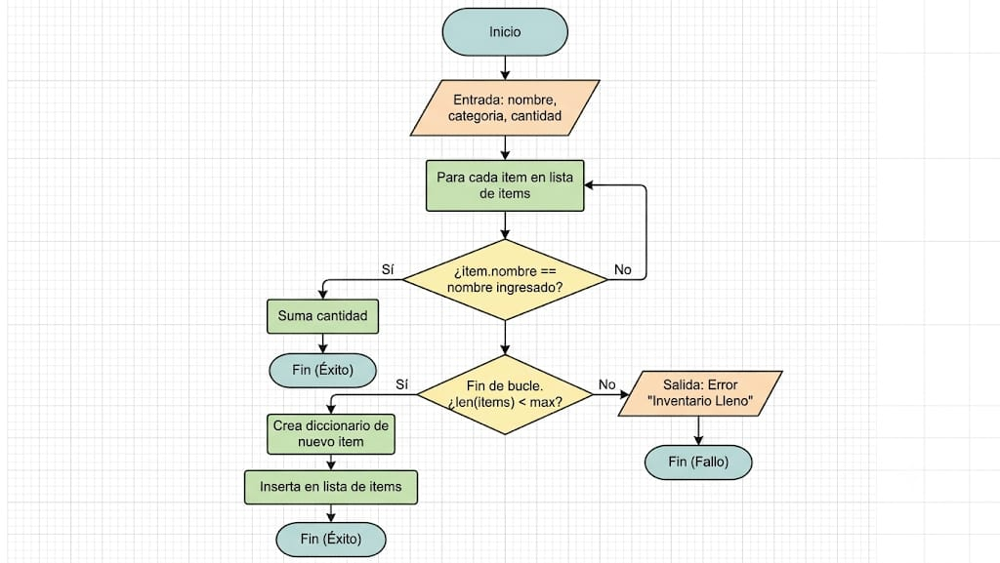

# Entregable: Aventura Algorítmica (Semanas 1 a 3)

### Integrantes:
* Leonardo Josué Graciano Lara
* Roberto Javier Ayala Pérez

## 1. Concepto del Juego
**Awakening of Makhai (Aventura Algorítmica)** es un juego de acción y exploración en 2D con vista cenital. El juego integra mecánicas de estructuras de datos (pilas, colas y listas) directamente en la jugabilidad.

* **Mundo:** Una oscura mazmorra subterránea llena de obstáculos, trampas y salas interconectadas.
* **Protagonista:** Jarek, un guerrero capaz de realizar rápidos "dashes" y combos de ataque cuerpo a cuerpo.
* **Antagonista:** Makhai, una entidad oscura que aguarda en las profundidades de la mazmorra.
* **Objeto Especial:** El Corazón de Cuarzo Roto.
* **Problema a resolver:** Jarek debe explorar la mazmorra gestionando sus recursos, encontrar los fragmentos del Corazón de Cuarzo Roto y utilizar su poder para debilitar y derrotar a Makhai antes de que despierte por completo.

## 2. Estructura de Archivos (Guía 1)
La carpeta del proyecto sigue un orden lógico para separar los recursos visuales de la lógica de programación:

*   **assets/**: Recursos gráficos (sprites del jugador y efectos visuales).
*   **main.py**: Bucle principal y renderizado del juego.
*   **inventario.py**: Lógica y almacenamiento de la mochila (Listas).
*   **jugador.py**: Máquina de estados, animación y físicas.
*   **buscador.py**: Algoritmos de búsqueda y filtrado.
*   **historial.py**: Sistema de deshacer movimientos (Pila LIFO).
*   **eventos.py**: Gestor de combos y daños (Cola FIFO).
*   **mapas.py**: Matriz de la sala inicial.
*   **README.md**: Este documento de documentación.

## 3. Diagrama de Flujo y Pseudocódigo (Mecánica: Inventario)
A continuación, se detalla el comportamiento del sistema de inventario, el cual se encarga de recibir objetos, verificar si ya existen para apilarlos, o agregarlos a un nuevo espacio si la capacidad lo permite.

**Diagrama de Flujo (Guía 2):**


**Pseudocódigo de la función `agregar_item`:**
    INICIO agregar_item(nombre, categoria, cantidad)
        // 1. Verificar si el objeto ya existe para apilarlo
        PARA CADA item EN mochila.items:
            SI item.nombre ES IGUAL A nombre ENTONCES:
                item.cantidad = item.cantidad + cantidad
                MOSTRAR "Se sumaron [cantidad] de [nombre]"
                RETORNAR Verdadero
            FIN SI
        FIN PARA

        // 2. Si no existe, verificar si hay espacio en la mochila
        SI TAMAÑO_DE(mochila.items) < capacidad_maxima ENTONCES:
            NUEVO_ITEM = {nombre, categoria, cantidad}
            AÑADIR NUEVO_ITEM A mochila.items
            MOSTRAR "Nuevo objeto recogido"
            RETORNAR Verdadero
        SINO:
            MOSTRAR "Inventario lleno"
            RETORNAR Falso
        FIN SI
    FIN

## 4. Evidencia de Ejecución del Inventario
El sistema de inventario funciona correctamente en el entorno gráfico con listas en Python. Al presionar la tecla **'I'**, se abre la interfaz de la mochila. Al presionar **'F'**, el sistema simula la recolección de una `"Llave Antigua"`, agregándola a la lista subyacente de Python e imprimiendo la confirmación en la consola. La interfaz gráfica se actualiza en tiempo real mostrando los objetos y sus cantidades.

# Awakening of Makhai - Aventura Algorítmica (Checkpoint 2)

## 1. Cómo ejecutar el juego
1. Asegúrate de tener Python 3 y la librería `pygame` instalada (`pip install pygame`).
2. Ejecuta el archivo principal desde la raíz del proyecto:
   ```bash
   python main.py