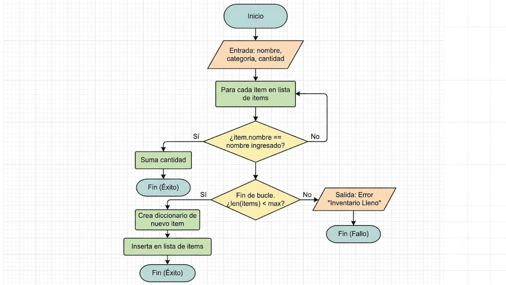

# Entregable: Aventura Algorítmica (Checkpoint 1, Checkpoint 2 y Checkpoint 3)

### Integrantes:
* **Leonardo Josué Graciano Lara**
* **Roberto Javier Ayala Pérez**

---

## 1. Concepto del Juego (Base Checkpoint 1)
**Awakening of Makhai (Aventura Algorítmica)** es un juego de acción y exploración en 2D con vista cenital e interfaz híbrida (Pygame + Consola). El juego integra mecánicas de estructuras de datos (listas, pilas, colas, árboles recursivos, grafos y diccionarios) directamente en la jugabilidad.

* **Mundo:** Una oscura mazmorra subterránea llena de obstáculos, trampas y salas interconectadas generadas recursivamente, conectada a una red de regiones principales.
* **Protagonista:** Jarek / Makhai, un guerrero capaz de realizar rápidos "dashes" y combos de ataque cuerpo a cuerpo.
* **Antagonista:** Makhai / El Centinela de Cuarzo, una entidad oscura que aguarda en las profundidades de la mazmorra.
* **Objeto Especial:** El Corazón de Cuarzo Roto y la Llave Lunar.
* **Problema a resolver:** El jugador debe explorar la mazmorra gestionando sus recursos en el inventario, retroceder estratégicamente usando su historial de pasos, enfrentar los eventos y turnos de combate, navegar rutas óptimas en el grafo del mapa y desbloquear las misiones jerárquicas para enfrentar al jefe final.

---

## 2. Estructura de Archivos (Checkpoint 1 a Checkpoint 3)
La carpeta del proyecto sigue una arquitectura modular donde `main.py` importa cada estructura sin duplicar código:

* **`assets/`**: Recursos gráficos (sprites del jugador y efectos visuales).
* **`main.py`**: Archivo central que integra todas las estructuras, el bucle gráfico de Pygame, el panel HUD desplegable y el menú interactivo de consola.
* **`inventario.py`**: Lógica y almacenamiento de la mochila mediante Listas (Checkpoint 1).
* **`buscador.py`**: Algoritmos de búsqueda lineal y filtrado por categoría (Checkpoint 1).
* **`historial.py`**: Historial de acciones y *backtracking* real entre salas usando una Pila LIFO (Semana 5 / Guía 5).
* **`eventos.py`**: Gestor de eventos del mapa y sistema rotativo de turnos usando Colas FIFO con `collections.deque` (Semana 6 / Guía 6).
* **`mazmorra.py`**: Generación recursiva del árbol de salas de la mazmorra y recorrido jerárquico (Semana 7 / Guía 7).
* **`grafo.py`**: Implementación genérica de grafo con lista de adyacencia y búsquedas **BFS** y **DFS** para navegación entre regiones (Checkpoint 3).
* **`arboles.py`**: Árbol general de misiones dependientes (recorridos preorden, postorden y por niveles) y árbol binario de decisión para IA enemiga (Checkpoint 3).
* **`estado_mundo.py`**: Gestión dinámica del estado del mundo mediante diccionario con consultas seguras (`.get()`), inserción, eliminación y filtros (Checkpoint 3).
* **`jugador.py`**: Máquina de estados, animación de sprites y físicas en Pygame.
* **`mapas.py`**: Prototipo de matriz de tiles de la sala inicial.
* **`README.md`**: Documentación técnica del proyecto.

---

## 3. Diagrama de Flujo y Pseudocódigo (Mecánica: Inventario - Checkpoint 1)
A continuación, se detalla el comportamiento del sistema de inventario, el cual se encarga de recibir objetos, verificar si ya existen para apilarlos, o agregarlos a un nuevo espacio si la capacidad lo permite.

**Diagrama de Flujo (Guía 2):**


**Pseudocódigo de la función `agregar_item`:**
```text
INICIO agregar_item(nombre, categoria, cantidad)
    // 1. Verificar si el objeto ya existe para apilarlo
    PARA CADA item EN mochila.items:
        SI item.nombre ES IGUAL A nombre ENTONCES:
            item.cantidad = item.cantidad + cantidad
            MOSTRAR "Se sumaron [cantidad] de [nombre]"
            RETORNAR Verdadero
        FIN SI
    FIN PARA

    // 2. Si no existe, verificar si hay espacio en la mochila
    SI TAMAÑO_DE(mochila.items) < capacidad_maxima ENTONCES:
        NUEVO_ITEM = {nombre, categoria, cantidad}
        AÑADIR NUEVO_ITEM A mochila.items
        MOSTRAR "Nuevo objeto recogido"
        RETORNAR Verdadero
    SINO:
        MOSTRAR "Inventario lleno"
        RETORNAR Falso
    FIN SI
FIN
```

---

## 4. Cómo Ejecutar el Juego (Checkpoint 2 y Checkpoint 3)
1. Asegúrate de tener Python 3 y la librería `pygame` instalada:
   ```bash
   pip install pygame
   ```
2. Ejecuta el archivo principal desde la raíz del proyecto:
   ```bash
   python main.py
   ```
   *(Opcional) Para ejecutar la demostración aislada de árboles en consola sin librerías externas:*
   ```bash
   python arboles.py
   ```
3. **Controles en la ventana de Pygame:**
   * `W, A, S, D`: Mover al personaje | `Alt Izq`: Dash | `Clic Izq`: Ataque / Combo.
   * `1` o `2`: Avanzar a la sala conectada 1 o 2 de la mazmorra recursiva (registra en Pila y dispara evento de la Cola).
   * `BACKSPACE`: Deshacer el último movimiento de mazmorra (*Backtracking* real a la sala anterior).
   * `F`: Recoger el objeto de la sala actual hacia el Inventario | `I`: Abrir/Cerrar Mochila en pantalla.
   * `T`: Rotar turno de combate | `H`: Ver historial en consola.
   * **`M`**: Abrir el **Menú de Consola Interactivo** para ejecutar todas las opciones y probar casos límite por teclado.
   * **`TAB`**: Abrir / cerrar el **Panel HUD en vivo** (Estado del Mundo, Mapa/Grafo y Árbol de Misiones).
   * **`F1` a `F5`**: Viajar entre regiones del grafo utilizando rutas más cortas (**BFS**).
   * **`C`**: Completar la siguiente misión disponible en el árbol.
   * **`B`**: Probar caso límite intentando completar una misión bloqueada sin prerrequisitos.
   * **`U`**: Deshacer el último desplazamiento en el grafo y revertir el estado del mundo (Pila).

---

## 5. Documentación Técnica de las Estructuras (Checkpoint 2)

### A. Historial de Acciones con Pila (`historial.py` - Semana 5 / Guía 5)
* **Mecánica que implementa:** Registra cada acción importante del jugador (moverse entre salas y recoger objetos) y permite deshacer pasos para regresar físicamente a la sala anterior (*backtracking*).
* **Por qué la Pila (LIFO) es la estructura adecuada:** Para retroceder sobre nuestros pasos en un laberinto o mazmorra, es indispensable revertir primero el movimiento más reciente que acabamos de hacer (*Last-In, First-Out*). Una pila garantiza que el último lugar visitado sea el primero al que regresamos.
* **Complejidad de operaciones:**
  * Registrar acción con `append()`: **$O(1)$** (tiempo constante amortizado).
  * Deshacer última acción con `pop()`: **$O(1)$** (extrae el tope de la lista sin reacomodar el resto de elementos).
  * Consultar la última acción sin sacarla (`self.pila[-1]`): **$O(1)$**.
  * Mostrar historial completo o contar por tipo: **$O(n)$**, donde $n$ es el número de acciones en el historial.
* **Funciones adaptadas de la Guía 5 incluidas:** `contar_acciones_de_tipo()` y `deshacer_multiples()`.
* **Fragmento de código relevante:**
  ```python
  def guardar_accion(self, tipo, descripcion, sala_origen, pos_origen=(400, 300)):
      """LIFO: Registra una acción importante en el tope de la pila con append()."""
      accion = {"tipo": tipo, "descripcion": descripcion, "sala_origen": sala_origen, "pos_origen": pos_origen}
      self.pila.append(accion)

  def deshacer_accion(self):
      """LIFO: Extrae y devuelve la última acción con pop(). Maneja el caso límite de pila vacía."""
      if len(self.pila) > 0:
          return self.pila.pop()
      print("[!] Caso límite: No hay movimientos que deshacer, el historial está vacío.")
      return None
  ```

### B. Eventos del Mapa y Sistema de Turnos con Cola (`eventos.py` - Semana 6 / Guía 6)
* **Mecánica que implementa:** Encola los eventos de la mazmorra (enemigos, trampas, cofres, mensajes) al iniciar la partida para dispararlos en orden cada vez que el jugador entra a una sala, y gestiona el orden de actuación en combate entre 3 participantes (`Makhai`, `Jarek` y `Centinela de Cuarzo`).
* **Por qué la Cola (FIFO) es la estructura adecuada:** Tanto los sucesos secuenciales de exploración como los turnos de combate requieren procesarse en estricto orden de llegada (*First-In, First-Out*) para mantener la coherencia temporal y que ningún participante actúe dos veces sin que los demás hayan tenido su turno.
* **Complejidad algorítmica (`deque.popleft()` vs `list.pop(0)`):**
  * Utilizamos **`collections.deque`** porque extraer el primer elemento con **`popleft()` tiene complejidad $O(1)$** (tiempo constante), dado que `deque` está implementada internamente como una lista doblemente enlazada de bloques y solo actualiza el puntero inicial.
  * Por el contrario, usar una lista común con **`list.pop(0)` tendría complejidad $O(n)$** (tiempo lineal), ya que tras eliminar el índice `0`, Python se ve obligado a desplazar en memoria todos los $n - 1$ elementos restantes una posición hacia la izquierda.
* **Decisión sobre qué pasa con un evento cuando se deshace un movimiento:** Decidimos como equipo que **cuando se deshace un movimiento, el evento disparado se pierde (no regresa a la cola)**. A nivel lógico y narrativo, si el jugador entra a una sala y activa una trampa de dardos o descubre a un enemigo, ese suceso ya ocurrió en el tiempo de la partida; retroceder a la sala anterior permite ponerse a salvo, pero no "des-activa" la trampa que ya se disparó.
* **Funciones adaptadas de la Guía 6 incluidas:** `contar_eventos_de_tipo()` y `simular_turnos()`.
* **Fragmento de código relevante:**
  ```python
  def procesar_siguiente_evento_mapa(self):
      """Extrae y procesa el evento más antiguo del mapa con popleft() en O(1)."""
      if len(self.cola_mapa) > 0:
          return self.cola_mapa.popleft()
      return None

  def avanzar_turno(self):
      """Rota el turno actual: saca al primero con popleft() y lo reingresa al final con append()."""
      if len(self.cola_turnos) > 0:
          participante_actual = self.cola_turnos.popleft()
          self.cola_turnos.append(participante_actual)
          return participante_actual
  ```

### C. Mazmorra Generada con Recursividad (`mazmorra.py` - Semana 7 / Guía 7)
* **Mecánica que implementa:** Genera dinámicamente la red de salas conectadas de la mazmorra (7 salas con nombres propios y profundidad 2), ubica tesoros/objetos en las salas más profundas y calcula estadísticas por nivel.
* **Por qué la Recursividad es adecuada:** Una mazmorra con bifurcaciones es naturalmente una estructura jerárquica en forma de árbol, donde cada sala conectada es a su vez la raíz de una sub-mazmorra más pequeña con la misma estructura.
* **Caso Base y Caso Recursivo:**
  * *Caso Base:* `if nivel_actual > profundidad_maxima: return None` (detiene las llamadas recursivas al alcanzar el límite de profundidad).
  * *Caso Recursivo:* Crea la sala del nivel actual y se invoca a sí misma dos veces con `nivel_actual + 1` para generar y enlazar las salas hijas.
* **Complejidad:** Tiempo **$O(V)$** y espacio en pila de llamadas **$O(h)$**, donde $V$ es el número total de salas generadas ($2^{h+1}-1 = 7$) y $h$ es la profundidad máxima ($2$).
* **Adaptaciones de la Guía 7 incluidas:** `marcar_salas_profundas()`, `contar_salas_por_nivel()` y `calcular_profundidad_real()`.
* **Fragmento de código relevante:**
  ```python
  def generar_mazmorra_recursiva(nivel_actual, profundidad_maxima, iter_nombres):
      # 1. CASO BASE
      if nivel_actual > profundidad_maxima:
          return None
      nueva_sala = {"nombre": next(iter_nombres), "nivel": nivel_actual, "item": None, "jefe": False, "conexiones": []}
      # 2. CASO RECURSIVO
      sala_izquierda = generar_mazmorra_recursiva(nivel_actual + 1, profundidad_maxima, iter_nombres)
      sala_derecha = generar_mazmorra_recursiva(nivel_actual + 1, profundidad_maxima, iter_nombres)
      if sala_izquierda: nueva_sala["conexiones"].append(sala_izquierda)
      if sala_derecha: nueva_sala["conexiones"].append(sala_derecha)
      return nueva_sala
  ```

---

## 6. Documentación Técnica de las Estructuras (Checkpoint 3)

### A. Mapa Interconectado con Grafo Genérico (`grafo.py` - Semanas 12 y 13)
* **Mecánica que implementa:** Modela la red de regiones principales de *Awakening of Makhai* (`Umbral de Piedra`, `Forja de Obsidiana`, `Puente Antiguo`, `Santuario Lunar` y `Cámara de Makhai`), calculando rutas óptimas entre salas y verificando qué zonas son alcanzables cuando hay bloqueos.
* **Por qué el Grafo es la estructura adecuada:** A diferencia de un árbol, el mapa del mundo contiene múltiples caminos alternativos y ciclos (se puede llegar al *Santuario Lunar* tanto por la *Forja* como por el *Puente*). Una lista de adyacencia representa estas conexiones bidireccionales sin duplicar nodos.
* **Complejidad de operaciones:**
  * `bfs_ruta_corta()` (Búsqueda en Anchura): **$O(V + E)$**, garantiza encontrar el camino con menor número de saltos entre dos salas.
  * `dfs_zonas_alcanzables()` (Búsqueda en Profundidad): **$O(V + E)$**, recorre todas las salas conectadas accesibles antes de toparse con una puerta cerrada.
  *(Donde $V$ es el número de salas/vértices y $E$ el número de caminos/aristas).*

### B. Árbol de Misiones y Árbol de Decisión (`arboles.py` - Semana 14)
* **Mecánica que implementa:** 
  1. **Árbol General de Misiones:** Organiza 8 misiones en 3 niveles de profundidad con bloqueo automático si no se ha completado la misión padre.
  2. **Árbol Binario de Decisión:** Modela el comportamiento táctico de los enemigos evaluando condiciones del entorno (`jugador_cerca`, `vida_baja`, `jefe_alerta`).
* **Por qué el Árbol es la estructura adecuada:** Las misiones siguen una jerarquía estricta de dependencias (prerrequisitos), mientras que la IA enemiga requiere tomar decisiones binarias rápidas bajando desde la raíz hasta una acción hoja.
* **Complejidad de operaciones:**
  * Recorridos `preorden()`, `postorden_recompensas()` (suma total de oro del árbol) y `recorrido_por_niveles()`: **$O(n)$**, donde $n$ es el total de misiones.
  * Evaluación de decisión `decidir(nodo, situacion)`: **$O(h)$**, donde $h$ es la altura del árbol de decisión (en el peor caso, si el árbol quedara degenerado en una sola línea, $h = n$ y sería $O(n)$).

### C. Estado Dinámico del Mundo con Diccionario (`estado_mundo.py` - Semana 15)
* **Mecánica que implementa:** Almacena y actualiza en tiempo real la sala actual, el oro acumulado, llaves obtenidas (`llave_lunar`), estados de bloqueo (`camara_makhai_bloqueada`) y mejoras temporales (`buff_forja`).
* **Por qué el Diccionario es la estructura adecuada:** El bucle gráfico de Pygame consulta y modifica banderas de estado en cada fotograma. El acceso por clave hash ofrece complejidad **$O(1)$ promedio**, evitando tener que recorrer una lista completa en **$O(n)$** cada vez que se verifica si una puerta está abierta. Además, el uso de `.get()` y `.pop()` previene errores `KeyError` ante claves inexistentes.

### D. Integración Cruzada y Decisión al Deshacer (`[U]`)
* **Trabajo conjunto de las estructuras:** Viajar por el **Grafo** (`[F1]`-`[F5]`) consulta los bloqueos en el **Diccionario**; entrar a la *Forja* inserta `"buff_forja"` en el diccionario y completa la misión raíz en el **Árbol**; entrar al *Santuario Lunar* elimina `"buff_forja"` e inserta `"llave_lunar"`, desbloqueando la ruta **BFS** hacia la *Cámara de Makhai*.
* **Decisión sobre el estado al deshacer:** Al presionar **`[U]`**, se extrae el último estado guardado en `self.pila_deshacer` (Checkpoint 2) y se revierten en el diccionario la sala actual, el oro y la posesión de la *Llave Lunar* (volviendo a bloquear la *Cámara de Makhai* en el grafo). Las misiones ya completadas en el árbol se conservan para no romper la progresión narrativa.

---

## 7. Diagramas de Estructuras

### Árbol de la Mazmorra Generada (`mazmorra.py`)
```text
└── Sala de Inicio: Umbral de Piedra (Nivel 0)
    └── Pasillo de los Faroles Caídos (Nivel 1)
        └── Galería de las Estatuas Antiguas (Nivel 2) [🎁 Item: Corazón de Cuarzo Roto]
        └── Cámara del Eco de Jarek (Nivel 2) [🎁 Item: Poción de Salud Ancestral]
    └── Santuario del Cuarzo Roto (Nivel 1)
        └── Forja de las Sombras (Nivel 2) [🎁 Item: Espada de Cuarzo]
        └── Altar del Despertar de Makhai (Nivel 2) [🎁 Item: Llave de las Sombras] [💀 JEFE]
```

### Grafo del Mapa (`construir_mapa_makhai`)
```text
                    [Forja de Obsidiana]
                   /                    \
[Umbral de Piedra]                      [Santuario Lunar] --- (Llave Lunar) --- [Cámara de Makhai]
                   \                    /
                     [Puente Antiguo]
```

### Árbol de Misiones (`construir_arbol_misiones`)
```text
[1. Despertar en el Umbral de Piedra] (Nivel 0 - Raíz)
 ├── [2. Forjar la Hoja de Obsidiana] (Nivel 1)
 │    ├── [4. Inscribir Runas de Poder] (Nivel 2 - Hoja)
 │    └── [5. Templar el Acero Lunar] (Nivel 2)
 │         └── [8. Confrontar al Señor de Makhai] (Nivel 3 - Hoja)
 └── [3. Recuperar el Amuleto de Jarek] (Nivel 1)
      ├── [6. Derrotar al Guardián del Puente] (Nivel 2 - Hoja)
      └── [7. Descifrar el Pergamino Ancestral] (Nivel 2 - Hoja)
```

---

## 8. Aporte de Cada Integrante
* **Leonardo Josué Graciano Lara:** Implementación del módulo de Historial con Pila (`historial.py`), generación recursiva de la mazmorra (`mazmorra.py`), implementación de `arboles.py` (recorridos preorden, postorden, por niveles y árbol de decisión), integración general en `main.py` (motor gráfico Pygame, panel HUD interactivo y menú de consola) y validación de casos límite.
* **Roberto Javier Ayala Pérez:** Implementación del módulo de Eventos y Turnos con Cola usando `deque` (`eventos.py`), acoplamiento con el sistema de Inventario y Buscador del Checkpoint 1 (`inventario.py`, `buscador.py`), implementación de la clase genérica `Grafo` (`grafo.py`), gestión de `estado_mundo.py`, pruebas de ejecución y elaboración de la documentación técnica en `README.md`.

---

## 9. Evidencia de Ejecución (Partida Completa y Casos Límite)

```text
=== Awakening of Makhai: La Cripta del Cuarzo ===
Mazmorra generada: 7 salas, profundidad 2
Salas por nivel: {0: 1, 1: 2, 2: 4}
Estás en: Sala de Inicio: Umbral de Piedra

=======================================================
   MODO CONSOLA INTERACTIVA (EVIDENCIA CHECKPOINT 2)   
=======================================================

Estás en: Sala de Inicio: Umbral de Piedra (Nivel 0)
1. Moverse  2. Ver inventario / Recoger  3. Deshacer movimiento
4. Ver historial y estadísticas  5. Ver/Simular turnos  6. Ver árbol de mazmorra  7. Volver a ventana Pygame
Opción: 6

--- ÁRBOL DE LA MAZMORRA RECURSIVA ---
└── Sala de Inicio: Umbral de Piedra (Nivel 0)
    └── Pasillo de los Faroles Caídos (Nivel 1)
        └── Galería de las Estatuas Antiguas (Nivel 2) [🎁 Item: Corazón de Cuarzo Roto]
        └── Cámara del Eco de Jarek (Nivel 2) [🎁 Item: Poción de Salud Ancestral]
    └── Santuario del Cuarzo Roto (Nivel 1)
        └── Forja de las Sombras (Nivel 2) [🎁 Item: Espada de Cuarzo]
        └── Altar del Despertar de Makhai (Nivel 2) [🎁 Item: Llave de las Sombras] [💀 JEFE]

Estás en: Sala de Inicio: Umbral de Piedra (Nivel 0)
1. Moverse  2. Ver inventario / Recoger  3. Deshacer movimiento
4. Ver historial y estadísticas  5. Ver/Simular turnos  6. Ver árbol de mazmorra  7. Volver a ventana Pygame
Opción: 1
Salas conectadas: 1) Pasillo de los Faroles Caídos  2) Santuario del Cuarzo Roto
Elige una sala: 1
[+] Historial (append): [MOVIMIENTO] Avanzó a 'Pasillo de los Faroles Caídos' (Desde: Sala de Inicio: Umbral de Piedra) | Total en pila: 1

[>] Te mueves a: Pasillo de los Faroles Caídos (Nivel 1)
⚡ Evento [ENEMIGO]: Un Centinela de Cuarzo emerge de las sombras y bloquea el paso. (Quedan 5 eventos)

Estás en: Pasillo de los Faroles Caídos (Nivel 1)
1. Moverse  2. Ver inventario / Recoger  3. Deshacer movimiento
4. Ver historial y estadísticas  5. Ver/Simular turnos  6. Ver árbol de mazmorra  7. Volver a ventana Pygame
Opción: 1
Salas conectadas: 1) Galería de las Estatuas Antiguas  2) Cámara del Eco de Jarek
Elige una sala: 2
[+] Historial (append): [MOVIMIENTO] Avanzó a 'Cámara del Eco de Jarek' (Desde: Pasillo de los Faroles Caídos) | Total en pila: 2

[>] Te mueves a: Cámara del Eco de Jarek (Nivel 2)
[*] ¡Brilla un objeto en esta sala!: Poción de Salud Ancestral (Presiona F o usa opción Recoger)
⚡ Evento [TRAMPA]: Pisas una baldosa hundida: dardos antiguos cruzan el pasillo. (Quedan 4 eventos)

Estás en: Cámara del Eco de Jarek (Nivel 2)
Objeto en el suelo: Poción de Salud Ancestral
1. Moverse  2. Ver inventario / Recoger  3. Deshacer movimiento
4. Ver historial y estadísticas  5. Ver/Simular turnos  6. Ver árbol de mazmorra  7. Volver a ventana Pygame
Opción: 2
[+] Nuevo objeto recogido: Poción de Salud Ancestral (Consumible)
[+] Historial (append): [RECOGER] Recogió 'Poción de Salud Ancestral' (Desde: Cámara del Eco de Jarek) | Total en pila: 3

--- MOCHILA DEL JUGADOR ---
- Poción de Salud Ancestral x1 [Consumible]
---------------------------

Estás en: Cámara del Eco de Jarek (Nivel 2)
1. Moverse  2. Ver inventario / Recoger  3. Deshacer movimiento
4. Ver historial y estadísticas  5. Ver/Simular turnos  6. Ver árbol de mazmorra  7. Volver a ventana Pygame
Opción: 5

--- ⚔️ SIMULACIÓN DE 3 TURNOS DE COMBATE ---
  Turno 1: Actúa -> Makhai (Jugador) (En espera: Jarek (Aliado), Centinela de Cuarzo (Enemigo), Makhai (Jugador))
  Turno 2: Actúa -> Jarek (Aliado) (En espera: Centinela de Cuarzo (Enemigo), Makhai (Jugador), Jarek (Aliado))
  Turno 3: Actúa -> Centinela de Cuarzo (Enemigo) (En espera: Makhai (Jugador), Jarek (Aliado), Centinela de Cuarzo (Enemigo))
--------------------------------------------------

Estás en: Cámara del Eco de Jarek (Nivel 2)
1. Moverse  2. Ver inventario / Recoger  3. Deshacer movimiento
4. Ver historial y estadísticas  5. Ver/Simular turnos  6. Ver árbol de mazmorra  7. Volver a ventana Pygame
Opción: 4
[?] Última acción en cima: [RECOGER] Recogió 'Poción de Salud Ancestral'

--- 📜 HISTORIAL DE ACCIONES (Más reciente -> Más antigua) ---
  1. [RECOGER] Recogió 'Poción de Salud Ancestral' (Origen: Cámara del Eco de Jarek)
  2. [MOVIMIENTO] Avanzó a 'Cámara del Eco de Jarek' (Origen: Pasillo de los Faroles Caídos)
  3. [MOVIMIENTO] Avanzó a 'Pasillo de los Faroles Caídos' (Origen: Sala de Inicio: Umbral de Piedra)
--------------------------------------------------------------

[#] Total de acciones de tipo 'movimiento': 2
[#] Eventos pendientes de tipo 'enemigo': 1

Estás en: Cámara del Eco de Jarek (Nivel 2)
1. Moverse  2. Ver inventario / Recoger  3. Deshacer movimiento
4. Ver historial y estadísticas  5. Ver/Simular turnos  6. Ver árbol de mazmorra  7. Volver a ventana Pygame
Opción: 3
[-] Deshaciendo (pop): Recogió 'Poción de Salud Ancestral' -> Volviendo a 'Cámara del Eco de Jarek'
[<] Backtracking completado: estás de vuelta en 'Cámara del Eco de Jarek'.

Estás en: Cámara del Eco de Jarek (Nivel 2)
1. Moverse  2. Ver inventario / Recoger  3. Deshacer movimiento
4. Ver historial y estadísticas  5. Ver/Simular turnos  6. Ver árbol de mazmorra  7. Volver a ventana Pygame
Opción: 3
[-] Deshaciendo (pop): Avanzó a 'Cámara del Eco de Jarek' -> Volviendo a 'Pasillo de los Faroles Caídos'
[<] Backtracking completado: estás de vuelta en 'Pasillo de los Faroles Caídos'.

Estás en: Pasillo de los Faroles Caídos (Nivel 1)
1. Moverse  2. Ver inventario / Recoger  3. Deshacer movimiento
4. Ver historial y estadísticas  5. Ver/Simular turnos  6. Ver árbol de mazmorra  7. Volver a ventana Pygame
Opción: 3
[-] Deshaciendo (pop): Avanzó a 'Pasillo de los Faroles Caídos' -> Volviendo a 'Sala de Inicio: Umbral de Piedra'
[<] Backtracking completado: estás de vuelta en 'Sala de Inicio: Umbral de Piedra'.

Estás en: Sala de Inicio: Umbral de Piedra (Nivel 0)
1. Moverse  2. Ver inventario / Recoger  3. Deshacer movimiento
4. Ver historial y estadísticas  5. Ver/Simular turnos  6. Ver árbol de mazmorra  7. Volver a ventana Pygame
Opción: 3
[!] Caso límite: No hay movimientos que deshacer, el historial está vacío.

Estás en: Sala de Inicio: Umbral de Piedra (Nivel 0)
1. Moverse  2. Ver inventario / Recoger  3. Deshacer movimiento
4. Ver historial y estadísticas  5. Ver/Simular turnos  6. Ver árbol de mazmorra  7. Volver a ventana Pygame
Opción: 1
Salas conectadas: 1) Pasillo de los Faroles Caídos  2) Santuario del Cuarzo Roto
Elige una sala: 2
[+] Historial (append): [MOVIMIENTO] Avanzó a 'Santuario del Cuarzo Roto' (Desde: Sala de Inicio: Umbral de Piedra) | Total en pila: 1

[>] Te mueves a: Santuario del Cuarzo Roto (Nivel 1)
⚡ Evento [COFRE]: Descubres un cofre oxidado con suministros olvidados. (Quedan 3 eventos)

Estás en: Santuario del Cuarzo Roto (Nivel 1)
1. Moverse  2. Ver inventario / Recoger  3. Deshacer movimiento
4. Ver historial y estadísticas  5. Ver/Simular turnos  6. Ver árbol de mazmorra  7. Volver a ventana Pygame
Opción: hola
[!] Entrada inválida: debes ingresar un número entero, no texto.
Opción: 0
[!] Opción no válida. Elige un número entre 1 y 7.
Opción: -5
[!] Opción no válida. Elige un número entre 1 y 7.
Opción: 9
[!] Opción no válida. Elige un número entre 1 y 7.

--- EVIDENCIA CHECKPOINT 3 (GRAFO + ÁRBOL + DICCIONARIO + CASOS LÍMITE) ---
[!] Acceso denegado a 'Cámara de Makhai': sala bloqueada o sin ruta.
[+] Ruta BFS: Umbral de Piedra -> Forja de Obsidiana | ¡Misión 1 completada (+50 oro) y Buff de Forja obtenido!
[!] ERROR: La misión '8. Confrontar al Señor de Makhai' está BLOQUEADA. Debes completar su misión predecesora primero.
[+] Ruta BFS: Forja de Obsidiana -> Santuario Lunar
[+] ¡Llave Lunar obtenida (Buff de Forja consumido)! Cámara de Makhai desbloqueada.
[+] Viajaste por ruta BFS: Santuario Lunar -> Cámara de Makhai
[<-] Deshacer: regresaste a 'Santuario Lunar'.
```